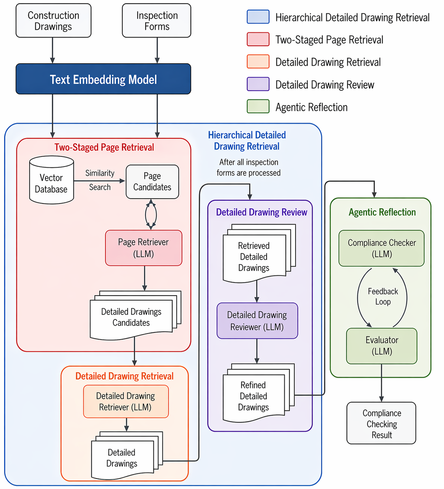

# HDDR

Hierarchical Detailed Drawing Retrieval (HDDR) system for engineering drawings. Uses multimodal LLMs (GPT-4o or o4-mini) + Neo4j vector search to retrieve relevant pages from engineering PDFs, extract detailed drawings, and verify compliance against inspection form specifications.



## Quick Start

Requirements: Python 3.11+ and [uv](https://docs.astral.sh/uv/). `pyproject.toml` installs
PyTorch from the CUDA 12.4 wheel index (Linux / Windows; the models also run on CPU). On macOS,
remove the `[tool.uv.sources]` and `[[tool.uv.index]]` entries to use the default PyPI wheels.

1. Clone and install:

   ```bash
   git clone https://github.com/CMMAi/HDDR.git
   cd HDDR
   uv sync
   ```

2. Copy `.env.template` to `.env` and fill in your credentials:

   ```ini
   OPENAI_API_KEY=...
   NEO4J_URI=...
   NEO4J_USERNAME=...
   NEO4J_PASSWORD=...
   NEO4J_DATABASE=...
   ```

3. Prepare your data as described in [Data](#data).

4. Build the knowledge graph:

   ```bash
   build-kg
   ```

5. Run experiments:

   ```bash
   run-ablation --dataset wall --set full --model_name gpt-4o-2024-08-06
   ```

   Each run writes to `output/<dataset>_<model>_<timestamp>/` (override with `--run_root`).

## Entry Points

After `uv sync` the following commands are available:

| Command | Module | Purpose |
|---------|--------|---------|
| `build-kg` | `compliance_checker.kg` | Build Neo4j knowledge graph from drawing books |
| `run-ablation` | `compliance_checker.ablation.experiments` | Run ablation experiments |
| `pdf-to-png` | `compliance_checker.pdf_to_png` | Convert PDF pages to PNG files using metadata.json |

You can also invoke them with `uv run`:

```bash
uv run build-kg --help
uv run run-ablation --help
uv run pdf-to-png --help
```

### `run-ablation` options

| Argument | Default | Description |
|----------|---------|-------------|
| `--dataset` | `wall` | `wall` (retaining wall), `pile` (full casing pile) or `ditch` (open ditch) |
| `--set` | `full` | `full` (module ablation), `reflection` (reflection-count ablation), or the index of a single configuration (see [Ablation configurations](#ablation-configurations)) |
| `--model_name` | `gpt-4o-2024-08-06` | `gpt-4o-2024-08-06` or `o4-mini-2025-04-16` |
| `--top_k` | `10` | Number of pages retrieved by similarity search |
| `--input_json_dir` | dataset default | Read the forms from another folder |
| `--run_root` | `output/<dataset>_<model>_<timestamp>` | Output directory for this run |

API keys and Neo4j credentials default to the values in `.env` and can be overridden with `--openai_api_key`, `--neo4j_uri`, `--neo4j_username`, `--neo4j_password` and `--neo4j_database`.

### `pdf-to-png` usage

```bash
pdf-to-png --pdf <path/to/book.pdf> --metadata <path/to/metadata.json> --output <output_dir> [--scale 3]
```

| Argument | Required | Default | Description |
|----------|----------|---------|-------------|
| `--pdf` | Yes | — | Path to the PDF file |
| `--metadata` | Yes | — | Path to `metadata.json` (maps DrawingNumber → page index) |
| `--output` | Yes | — | Directory where PNG files will be written |
| `--scale` | No | `3` | Scale factor for rendering resolution |

Output structure: `<output_dir>/<DrawingNumber>/<DrawingNumber>.png`

## Package Layout

```text
src/compliance_checker/
├── detection.py          # YOLO-based drawing segmentation (DDC)
├── clustering.py         # ResNet-50 + KMeans drawing review (DDReview)
├── prompts.py            # All LLM prompt templates
├── grading.py            # Rule-based correctness judge for check standards
├── metrics.py            # Per-item / per-run evaluation metrics
├── kg.py                 # Neo4j knowledge graph builder
├── pdf_to_png.py         # Convert PDF pages to PNG using metadata.json
└── ablation/
    └── experiments.py    # Main end-to-end ablation runner

tests/                    # Unit tests (pytest)
examples/data/            # Fictional template of the data layout and file formats
docs/                     # Figures used in this README

output/                   # Experiment results (gitignored)
weights/                  # Trained YOLOv12n detector for detailed drawings and tables
data/                     # Drawings and inspection forms (not distributed)
```

## Data

The drawings and inspection forms used in the paper come from two real-world projects and
**are not included** in this repository. For the same reason, the drawing numbers, positions and
design values in the few-shot examples of `prompts.py` (and in the tests) are fictional; the
prompt instructions are the same as those used in the paper. The trained detector for detailed
drawings and tables (YOLOv12n) is included as `weights/drawing_detection.pt`.

`examples/data/` contains a fictional template with the expected layout and file formats; copy it to start your own:

```bash
cp -r examples/data data
```

```text
data/
├── drawings/
│   └── <book>/                         # one directory per drawing book (PDF)
│       ├── metadata.json               # page index of the book (see below)
│       └── <DrawingNumber>/
│           ├── <DrawingNumber>.png     # produced by `pdf-to-png`
│           └── Detailed Drawings/      # created on first run by the YOLO detector (DDC)
├── test_forms_retaining_wall/          # inspection forms, `--dataset wall`
├── test_forms_full_casing_pile/        # inspection forms, `--dataset pile`
└── test_forms_open_ditch/              # inspection forms, `--dataset ditch`
```

What you need to provide:

| Item | How to obtain |
|------|---------------|
| Drawing PDFs | Your own project |
| `metadata.json` | Prepare per book (format below) |
| `<DrawingNumber>.png` | `pdf-to-png --pdf <book.pdf> --metadata <metadata.json> --output data/drawings/<book>` |
| Inspection forms | Prepare as JSON (format below) |

### `metadata.json`

One entry per PDF page that should be searchable:

```json
[
  {"DrawingPage": 3, "DrawingTitle": "RC擋土牆配筋圖", "DrawingNumber": "G-101"}
]
```

- `DrawingPage`: 1-based page index in the PDF.
- `DrawingNumber`: drawing number; also used as the page's directory name.
- `DrawingTitle`: drawing title; `build-kg` embeds it for the Neo4j similarity search.

`build-kg` indexes every book under `data/drawings/` that has a `metadata.json`. The drawing
number and title can be read from each sheet's title block by hand, or with an LLM using
`create_prompt_for_preprocessing` in `prompts.py`.

### Inspection forms

One JSON file per form, with the same format for all three datasets:

```json
{
  "construction": "示範道路新建工程",
  "form": "RC擋土牆工程施工抽查紀錄表",
  "position": "W1 擋土牆",
  "ground_truth_page": "G-101",
  "check_items": [
    {
      "check_item": "★基礎鋼筋及模板組立-主筋直徑、間距",
      "check_standard": "編號S1：依設計圖主筋直徑=16mm、間距=20cm",
      "check_standard_gt": "編號S1：依設計圖主筋直徑=22mm、間距=20cm",
      "origin": "",
      "compliance_with_regulations": "",
      "advised_standard": "",
      "reasoning": ""
    }
  ]
}
```

- Inputs: `construction`, `form`, `position`, `ground_truth_page`, and per item `check_item`,
  `check_standard`, `check_standard_gt`. `form` and `position` form the similarity-search query.
- Ground truth for evaluation: `ground_truth_page` must be a `DrawingNumber` in some
  `metadata.json`; `check_standard_gt` is the correct standard according to the drawing.
- Outputs (leave empty): `origin`, `compliance_with_regulations`, `advised_standard` and
  `reasoning` are filled in by `run-ablation` in the copies written to the output directory.
- Every form in a dataset must list the same check items in the same order, because
  DDReview clusters the drawings retrieved for each item position across forms.

## Architecture

Module abbreviations used below and in the code: **TSPR** = Two-Staged Page Retrieval,
**DDC** = Detailed Drawing Chunking (YOLO), **DDR** = Detailed Drawing Retrieval,
**DDReview** = Detailed Drawing Review (ResNet-50 + KMeans).

### Ablation configurations

All configurations use the Compliance Checker ↔ Evaluator loop. `--set` selects one of the two
experiments: `full` adds the modules one at a time (module ablation), and `reflection` keeps all
modules on while varying the maximum number of evaluator rounds (reflection-count ablation).

| `--set` | Index | Config | Page mode | DDC | DDR | DDReview | Evaluator rounds |
|---------|-------|--------|-----------|-----|-----|----------|------------------|
| `full` | 0 | Greedy | greedy | | | | ≤3 |
| `full` | 1 | Vanilla | vanilla | | | | ≤3 |
| `full` | 2 | DDC | vanilla | ✓ | | | ≤3 |
| `full` | 3 | TSPR\_DDC | tspr | ✓ | | | ≤3 |
| `full` | 4 | TSPR\_DDC\_DDR | tspr | ✓ | ✓ | | ≤3 |
| `full` | 5 | TSPR\_DDC\_DDR\_Rev | tspr | ✓ | ✓ | ✓ | ≤3 |
| `reflection` | 6 … 9 | Reflection\_0 … Reflection\_3 | tspr | ✓ | ✓ | ✓ | 0 … 3 |

`<model>` is `gpt-4o-2024-08-06` or `o4-mini-2025-04-16`:

```bash
run-ablation --dataset <dataset> --set full --model_name <model>        # module ablation
run-ablation --dataset <dataset> --set reflection --model_name <model>  # reflection-count ablation
```

`--set <index>` runs a single configuration. To check forms with the complete system without
running an ablation, use `--set 5` (all modules enabled).

### Page retrieval modes

| Mode | Description |
|------|-------------|
| `greedy` | Neo4j similarity search → top-1, no LLM verification |
| `vanilla` | Neo4j search → single-stage LLM content check |
| `tspr` | Neo4j search → two-stage LLM (position then content) |

### Outputs

Each run directory contains:

```text
output/<dataset>_<model>_<timestamp>/
├── summary.txt                      # page retrieval and compliance accuracy per configuration
├── log/status.log, log/form.log     # progress log and raw LLM responses
└── <Config>/
    ├── <form>.json                  # input form with origin / compliance / advised standard / reasoning filled in
    ├── reflection_iterations/       # checker ↔ evaluator exchange and selected drawings per form
    ├── latency_cost_report.json     # per-stage latency and token cost
    └── latency_cost_summary.txt
```

Token costs are estimated from the `PRICING` table in `metrics.py`, which holds the OpenAI list
prices used in our experiments. Update it to the current rates; models missing from the table are
costed at $0.

### Evaluation

- **Page retrieval accuracy**: the retrieved page equals `ground_truth_page`.
- **Compliance accuracy** (`summary.txt`): the advised standard matches `check_standard_gt`.

## Running Tests

```bash
uv run pytest
```

## External Services

| Service | Purpose |
|---------|---------|
| OpenAI `gpt-4o-2024-08-06` / `o4-mini-2025-04-16` | Vision + reasoning |
| OpenAI `text-embedding-3-small` | Page title embeddings for Neo4j search |
| Neo4j (e.g. Neo4j Aura) | Vector index for semantic page retrieval |
| Local YOLO (`weights/drawing_detection.pt`) | Drawing segmentation |

## License

This project is licensed under the GNU Affero General Public License v3.0 or later
(AGPL-3.0-or-later); see [LICENSE](LICENSE). It depends on
[Ultralytics YOLO](https://github.com/ultralytics/ultralytics), which is licensed under
AGPL-3.0, and the detector weights in `weights/` were trained with it.
